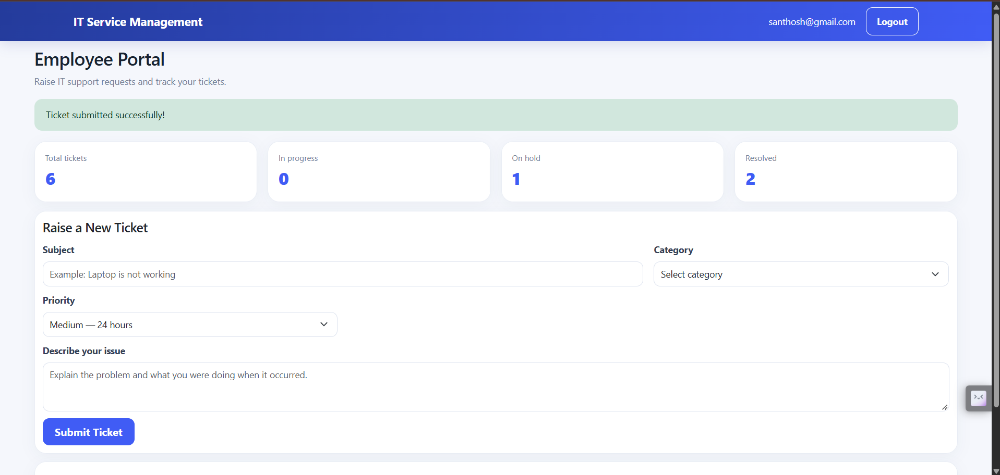
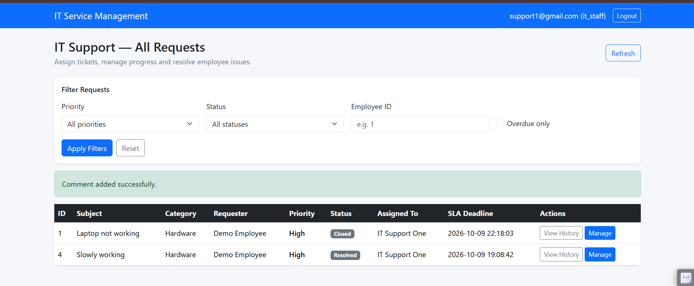

# IT Service Request Management System

A role-based web application built with Flask and MariaDB to manage IT support requests, assign tickets to IT staff, and track request progress from submission to resolution.

## Overview

The IT Service Request Management System provides a centralized platform for handling IT support requests within an organization. It separates responsibilities across employees, managers, and IT support staff to make request management more organized and efficient.

The application uses Flask for backend logic, a MariaDB database for persistent storage, and a responsive web interface for interacting with service requests.

## Features

- **Service Request Management** — Submit and manage IT support tickets.
- **Role-Based Access Control** — Provide separate workflows for employees, IT managers, and IT staff.
- **Ticket Assignment** — Assign and reassign requests to IT support personnel.
- **Status Tracking** — Monitor request progress and resolution status.
- **Request History** — Track ticket activity and changes.
- **Comments and Updates** — Support communication related to service requests.
- **SLA Tracking** — Display service-level agreement deadlines.
- **Dashboard Metrics** — Summarize ticket counts and statuses.
- **Secure Database Connection** — Connect to a remote database using PyMySQL and SSL certificate verification.

## User Roles

| Role | Responsibilities |
|---|---|
| Employee | Submit support requests, view personal tickets, and track progress. |
| IT Manager | View requests, assign or reassign tickets, and oversee service operations. |
| IT Staff | View assigned requests, update statuses, and record resolution details. |

## Technology Stack

| Component | Technology |
|---|---|
| Backend | Python, Flask |
| Database | MariaDB |
| Database Driver | PyMySQL |
| Frontend | HTML, CSS, JavaScript |
| UI Framework | Bootstrap |
| Configuration | Environment variables, python-dotenv |
| Database Security | SSL/TLS |
| Testing | pytest |
| Version Control | Git, GitHub |

## Project Structure

```text
IT_SERVICE_REQUEST_MANAGEMENT/
│
├── app.py                    # Flask application entry point
├── config.py                 # Application configuration
├── database.py               # Database connection management
│
├── routes/                   # Application routes and endpoints
├── services/                 # Application service logic
├── templates/                # HTML templates
├── static/                   # CSS, JavaScript, and static assets
├── tests/                    # Automated tests
├── certs/
│   └── globalsignrootca.pem  # SSL CA certificate
│
├── schema.sql                # Database schema
├── setup_db.py               # Database setup utility
├── create_database.py        # Database creation utility
├── seed_users.py              # User seeding utility
├── check_requests.py         # Request verification utility
├── check_users.py            # User verification utility
├── verify_db.py              # Database verification utility
│
├── requirements.txt          # Python dependencies
├── .gitignore                # Git exclusions
└── README.md                 # Project documentation
```


## Application Screenshots

### Employee Dashboard


### Manager Dashboard


### IT Staff Dashboard



## Getting Started

### Prerequisites

- Python installed on your system
- Git
- Access to a MariaDB database
- MariaDB connection credentials and SSL certificate details, if required by your database provider
- Visual Studio Code or another Python editor

### 1. Clone the Repository

```bash
git clone https://github.com/GowthamiNanapollu/IT_SERVICE_REQUEST_MANAGEMENT.git
cd IT_SERVICE_REQUEST_MANAGEMENT
```

### 2. Create a Virtual Environment

**Windows PowerShell**

```powershell
python -m venv .venv
.\.venv\Scripts\Activate.ps1
```

**Linux or macOS**

```bash
python3 -m venv .venv
source .venv/bin/activate
```

### 3. Install Dependencies

```bash
python -m pip install -r requirements.txt
```

## Environment Configuration

Create a `.env` file in the project root using the following variable names:

```dotenv
SECRET_KEY=replace_with_a_strong_random_secret

DB_HOST=your_database_host
DB_PORT=4019
DB_DATABASE=your_database_name
DB_USER=your_database_username
DB_PASSWORD=your_database_password
```

Replace the example values with your actual database configuration. The port shown reflects the current project configuration; use the port specified by your database provider.

**Security:** Never commit your `.env` file, database passwords, or other secrets to GitHub.

## Database Setup

The application uses MariaDB for persistent storage and PyMySQL to establish database connections.

The repository includes `schema.sql` and database setup utilities.

Configure the database connection variables in your .env file.

Ensure the MariaDB server is accessible using the configured host, port, username, and password.

Ensure the required database and tables have been created using the project's schema and setup utilities.

Verify the database connection before starting the application.

For remote database connections, the application uses SSL certificate verification through certs/globalsignrootca.pem, as configured in the database connection code.

Note: Review the database initialization scripts before running them against an existing database.

## Running the Application

Activate your virtual environment, then run:

```bash
python app.py
```

Open the local URL shown in your terminal. With the default Flask development settings, this is commonly:

```text
http://127.0.0.1:5000
```

The actual address and port depend on your application configuration.

## Testing

The project uses pytest for automated testing.

Run the tests from the project root:

```bash
python -m pytest -v
```

To run the database connection test specifically:

```bash
python -m pytest tests/test_database_connection.py -v
```

Database-dependent tests require valid environment variables, network access, and an accessible database.

## Security Practices

- Keep credentials in environment variables rather than source code.
- Exclude `.env` and `.venv/` from version control.
- Use a strong Flask secret key.
- Maintain SSL certificate verification for remote database connections.
- Enforce authorization on backend endpoints.
- Restrict access to requests according to each user's role.
- Avoid exposing administrative scripts or sensitive configuration.

## Future Enhancements

Potential improvements include:

- Email notifications for ticket assignments and status changes.
- Advanced SLA monitoring and overdue-request alerts.
- Analytics dashboards and downloadable reports.
- Expanded automated tests for role-based authorization.
- Audit logging and enhanced reporting.

## Author

**Gowthami Nanapollu**

GitHub: [GowthamiNanapollu](https://github.com/GowthamiNanapollu)

---

*Developed to simplify IT support workflows through centralized ticket management, role-based access, and secure database connectivity.*
